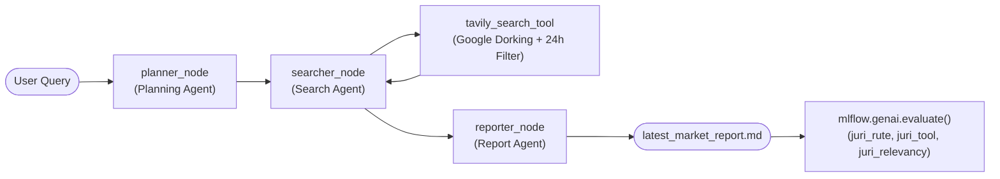

# 📈 AI Assistant Multi-Agent Market News Summary

Asisten AI berbasis **LangChain & LangGraph** dengan arsitektur **Agentic Multi-Agent** untuk mengumpulkan, menganalisis, dan merangkum berita pasar finansial (Saham, Makro/The Fed, Komoditas, Kripto) dalam kurun waktu **24 jam terakhir**.

Sistem ini memadukan model **Google AI Studio (Gemini)**, teknik pencarian **Google Dorking**, **Tavily Search API**, serta evaluasi & tracing komprehensif menggunakan **`mlflow.genai.evaluate()`** dan **`mlflow.autolog()`**.

---

## 🏛️ Arsitektur Multi-Agent & Node Tracing

Semua node dan pemanggilan tools di-instrumentasi dengan `@mlflow.trace` serta `mlflow.autolog()` agar seluruh input, output, dan urutan eksekusi terlihat jelas di tab **Traces** MLflow UI.



### 1. **Agent 1: Planning Agent (`planner_node`)**
- **Tugas:** Menganalisis instruksi atau fokus pasar pengguna.
- **Output:** Menghasilkan rencana riset terstruktur (objektif, subtopik, entitas/ticker penting seperti Federal Reserve, S&P 500, Nvidia, Minyak Mentah) yang spesifik untuk periode 24 jam terakhir.
- **Trace MLflow:** Tercatat sebagai span `planner_node` lengkap dengan input query dan output rencana riset JSON.

### 2. **Agent 2: Search Agent (`searcher_node`)**
- **Tugas:** Menerjemahkan setiap subtopik riset menjadi query **Google Dorking** presisi.
- **Teknik Google Dorking:**
  - `site:` membatasi pencarian ke media terpercaya (`reuters.com`, `bloomberg.com`, `cnbc.com`, `marketwatch.com`, `wsj.com`, dll.).
  - `intitle:` memastikan topik utama termuat di judul berita.
  - Tanda kutip `""` untuk *exact match phrase*.
- **Tools (`tavily_search_tool`):** Mengeksekusi pencarian melalui Tavily API dengan parameter `time_range="day"` (filter ketat 24 jam) dan `topic="news"`.
- **Trace MLflow:** Setiap pemanggilan tool terekam sebagai sub-span `tavily_search_tool` di bawah `searcher_node`.

### 3. **Agent 3: Report Agent (`reporter_node`)**
- **Tugas:** Mengolah seluruh berita yang berhasil dikumpulkan menjadi laporan komprehensif berstandar analis pasar modal dalam format Markdown.
- **Struktur Laporan:**
  1. 📌 Ringkasan Eksekutif & Sentimen Pasar (Risk-on / Risk-off)
  2. 🏛️ Kebijakan Makroekonomi & Bank Sentral (The Fed / Suku Bunga)
  3. 📈 Pergerakan Indeks Saham & Sektor Kunci (Wall Street & Global)
  4. 💡 Katalis & Berita Korporasi Terhangat
  5. 🛢️ Komoditas, Valas & Aset Digital
  6. ⚖️ Sentimen Pasar & Outlook / Katalis Mendatang
  7. 🔗 Daftar Referensi Berita Terverifikasi (Link sumber langsung)
- **Trace MLflow:** Tercatat sebagai span `reporter_node` yang menghasilkan laporan final.

---

## ⚖️ Evaluasi

### 👨‍⚖️ Panel Juri Evaluasi:
1. **`juri_rute` (Trace Route Judge):**
   - Memeriksa apakah alur eksekusi agent melalui semua node wajib: `planner_node` -> `searcher_node` -> `reporter_node`.
   - Menginspeksi spans yang terekam pada trace MLflow.
2. **`juri_tool` (Tool Verification Judge):**
   - Memeriksa apakah `tavily_search_tool` benar-benar dipanggil dengan query Google Dorking dan filter 24 jam.
3. **`juri_relevancy` (Relevancy & Structure Judge):**
   - Memeriksa apakah laporan menjawab query pengguna, memuat bagian penting (Ringkasan Eksekutif, Makro, dan Sumber Berita), serta berbasis fakta berita 24 jam.

---

## 🚀 Panduan Menjalankan

### 1. Jalankan Assistant
```bash
python main.py --query "Berita pasar saham Wall Street, suku bunga The Fed, dan saham Nvidia 24 jam terakhir"
```

### 2. Jalankan Evaluasi Skenario Lengkap
```bash
python main.py --eval-all
```
atau langsung melalui modul evaluasi:
```bash
python evaluation/evaluate_agent.py
```

### 3. Membuka Dashboard MLflow UI
Buka terminal dan jalankan:
```bash
mlflow ui
```
Buka browser di **`http://127.0.0.1:5000`**:
- Masuk ke eksperimen **`Market_News_Agentic_Evaluation`**.
- Klik run evaluasi terkait.
- Buka tab **Traces** untuk melihat visualisasi alur node, input/output tiap agen, dan pemanggilan tool Tavily secara interaktif!
